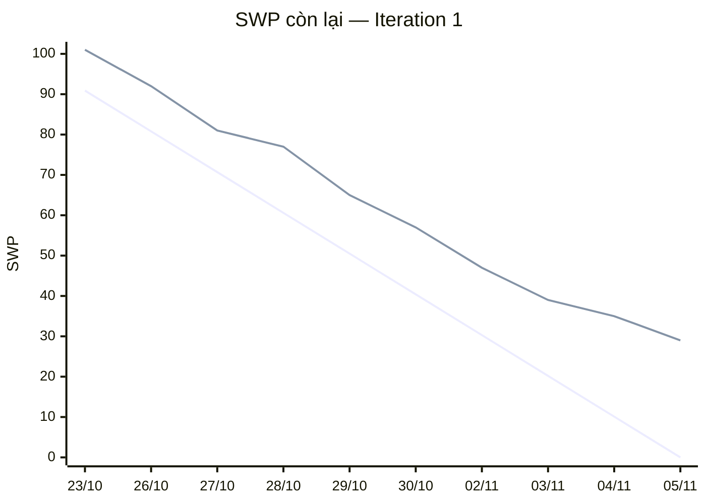

# Báo cáo tiến độ — Sprint 1

**Iteration trên Project:** Iteration 1 · **Khoảng thời gian giả lập:** 23/10/2026 – 05/11/2026 (10 ngày làm việc)
**Project:** https://github.com/users/mytcn-1511/projects/1 (lọc theo Iteration 1)

## Tóm tắt

- Sprint 1 hoàn thành **16/21 issue**, tức **72/101 SWP (71%)**. Phần nền tảng đã xong: bảng mã lỗi chung, môi trường thử, cấp mã giao dịch, chặn quyền theo vai, lịch chợ, hoàn tất giao nhận.
- Còn 29 SWP chuyển sang Sprint 2. Nguyên nhân chính: chưa có trả lời của phía chợ về file ngày thanh toán (câu hỏi D-08), một issue vượt giờ ước và một issue trễ 2 ngày.
- **Phía chợ cần quyết hai việc:**
  1. Trước **10/11**: chốt định dạng file CSV ngày thanh toán do phòng kế toán xuất (câu hỏi D-08). Đây là điều kiện để tính thưởng thanh toán đủ hạn (完納奨励金) cho kỳ đầu tiên.
  2. Trước **13/11**: gửi hoặc xác nhận bảng tỷ lệ thưởng thật (câu hỏi D-39). Hiện hệ thống dùng bảng giả định chia bậc theo số tiền mua.
- **Cần phía chợ đồng ý:** đề xuất dời phần tư cách tham gia sang Sprint 3 (20/11–03/12) để Sprint 2 (06/11–19/11) tập trung vào chuỗi thưởng.

| Mã, từ | Nghĩa |
|---|---|
| SWP | Điểm độ lớn công việc (Standard Work Point), dùng để so khối lượng giữa các việc |
| 完納奨励金 | Tiền thưởng thanh toán đủ hạn cho bên mua |
| Done · In Progress · Todo | Đã xong · Đang làm · Chưa bắt đầu |
| Iteration | Một sprint, chu kỳ làm việc 2 tuần trên bảng quản lý GitHub Project |
| BrSE | Kỹ sư cầu nối giữa đội phát triển và phía chợ |
| API | Đường để màn hình gọi dữ liệu từ máy chủ |
| Kiểm trùng | Bước chặn nhập trùng cùng một dòng thanh toán hai lần |
| D-08, D-39 | Hai câu hỏi đã gửi phía chợ (ghi trong [PREMISE.md](PREMISE.md)): D-08 về nguồn ngày thanh toán, D-39 về bảng tỷ lệ thưởng thật |

## 1. Trạng thái

| Trạng thái | Số issue | Điểm độ lớn (SWP) | Ghi chú |
|---|---|---|---|
| Done | 16 | 72 | #9, #32, #43, #45, #60, #64, #110, #115, #116, #121, #126, #127, #144, #145, #152, #153 |
| In Progress | 4 | 25 | #61 đang kẹt chờ phía chợ xác nhận file CSV; #65 xong phần chọn bậc thưởng, còn phần đọc ngày thanh toán; #123 vượt giờ ước, còn khoảng 8 giờ; #129 còn bước kiểm tự động sau khi triển khai |
| Todo | 1 | 4 | #62 nhập tay ngày thanh toán, chờ #61 |
| **Tổng** | **21** | **101** | Tương đương 250 giờ ước lượng (200 giờ phía máy chủ và màn hình, 30 giờ kiểm thử, 20 giờ hạ tầng); đã xong 174 giờ |

Sức làm giả định của sprint: 2 người phía máy chủ và 2 người phía màn hình, mỗi người 6 giờ làm thật mỗi ngày, tổng 240 giờ; phần việc của họ trong sprint là 200 giờ. Kiểm thử (1 người) và hạ tầng (bán thời gian) tính riêng.

## 2. Biểu đồ tiến độ (SWP còn lại)

Trên biểu đồ, **đường thẳng đi xuống đều là kế hoạch**, **đường còn lại là thực tế** (chỉ giảm khi một issue chuyển Done). Bảng bên dưới ghi cùng số liệu.

| Ngày giả lập | Kế hoạch còn lại | Thực tế còn lại | Chênh | Issue xong trong ngày |
|---|---|---|---|---|
| 23/10 | 90,9 | 101 | +10,1 | — |
| 26/10 | 80,8 | 92 | +11,2 | #152, #60, #9 |
| 27/10 | 70,7 | 81 | +10,3 | #116, #126, #32 |
| 28/10 | 60,6 | 77 | +16,4 | #110 |
| 29/10 | 50,5 | 65 | +14,5 | #64, #115, #43 |
| 30/10 | 40,4 | 57 | +16,6 | #121 |
| 02/11 | 30,3 | 47 | +16,7 | #144, #45 |
| 03/11 | 20,2 | 39 | +18,8 | #127 |
| 04/11 | 10,1 | 35 | +24,9 | #145 |
| 05/11 | 0 | 29 | +29 | #153 |

**Thực tế lệch kế hoạch ở đâu:**
- **Ngày đầu chưa có issue nào xong.** Các nhóm cùng bắt đầu 6 issue nền tảng song song, nên việc đầu tiên xong vào ngày thứ hai. Khoảng 10 SWP chênh lúc đầu là do cách bắt đầu song song, không phải do chậm.
- **Ngày 28/10 chênh tăng lên 16 SWP.** API nhập file CSV ngày thanh toán (#61) phải dừng phần kiểm trùng, vì phía chợ chưa xác nhận cột và mã hoá ký tự của file. Issue nhập tay (#62) phụ thuộc #61 nên không bắt đầu được.
- **Từ 03/11 chênh tăng nhanh.** Script đặt lại dữ liệu mẫu (#127) xong trễ 2 ngày, vì phải tách riêng dữ liệu thử và dữ liệu demo. Việc này kéo theo máy kiểm tự động (#129) bắt đầu muộn. Cùng lúc, màn đăng ký xác thực hai lớp (#123) vượt giờ ước: đã dùng khoảng 28 trên 25 giờ.
- **Tốc độ thực tế của Sprint 1 là 72 SWP**, so với 101 SWP đã nhận vào sprint. Nếu giữ tốc độ này, phần còn lại của backlog (550 SWP) cần khoảng 8 sprint (550 ÷ 72 ≈ 7,6), thay vì khoảng 6 sprint như ước ban đầu (toàn bộ 622 SWP ÷ 101 SWP nhận vào mỗi sprint ≈ 6,2).

## 3. Rủi ro trễ

| Rủi ro | Issue | Ảnh hưởng tới mốc nào | Hành động | Ai làm, khi nào |
|---|---|---|---|---|
| Phía chợ chưa chốt cách đưa ngày thanh toán vào hệ thống (file CSV từ kế toán hay nhập tay), câu hỏi D-08 | #61, #62, #65; câu hỏi #134 | Tính thưởng thanh toán đủ hạn cho kỳ đầu tiên (#67–#69, dự kiến xong cuối Sprint 2, 19/11) | Tiếp tục theo giả định "file CSV từ kế toán, nhập tay cho ngoại lệ"; gửi lại câu hỏi kèm đặc tả file mẫu (#60); nếu đến 10/11 chưa có trả lời thì tạm lấy nhập tay làm nguồn chính để không chặn tính thưởng | BrSE gửi câu hỏi ngày 06/11; 山辺さん (phụ trách kế toán phía chợ) trả lời trước 10/11 |
| Bảng tỷ lệ thưởng thật chưa có, đang dùng giả định bậc theo số tiền, câu hỏi D-39 | #64 (đã xong theo giả định), #65; câu hỏi #135 | Chốt kỳ thưởng đầu tiên (#68, cuối Sprint 2, 19/11) | Giữ bảng giả định; khi có bảng thật chỉ nhập lại dữ liệu, không sửa chương trình; xin phía chợ xác nhận bảng thật | BrSE gửi câu hỏi ngày 06/11; phía chợ trả lời trước 13/11 |
| Màn đăng ký xác thực hai lớp vượt giờ ước (khoảng 28/25 giờ, còn khoảng 8 giờ) | #123 | Sức làm phía màn hình của Sprint 2; bước đăng nhập hai lớp (#124) | Chuyển phần còn lại sang Sprint 2; xem lại cách ước các issue dùng dịch vụ xác thực bên ngoài | Nhóm màn hình, xong trước 10/11 |
| Máy kiểm tự động chưa chạy được bước kiểm sau khi triển khai | #129, #127 | Bản demo cho phía chợ và mọi lần triển khai từ Sprint 2 | Ưu tiên hoàn tất #129 trong 2 ngày đầu Sprint 2; tới lúc đó, chạy tay bước kiểm nhanh sau mỗi lần triển khai | Hạ tầng và kiểm thử, 06–07/11 |
| Sprint 2 đã nhận 98 SWP, cộng 29 SWP chuyển từ Sprint 1 thành 127 SWP, khoảng 1,8 lần tốc độ thực tế 72 SWP | Toàn bộ Iteration 2 | Mốc hoàn thành chuỗi thưởng (19/11) và phần tư cách tham gia (dời sang Sprint 3, xong trước 03/12) | Họp lập kế hoạch Sprint 2: ưu tiên phần chuyển sang và chuỗi thưởng; dời khoảng 55 SWP sang Sprint 3, trước hết là phần tư cách tham gia (#17, #19, #20, #21, #23, #24, 33 SWP), phần còn lại chọn trong buổi lập kế hoạch; xin phía chợ đồng ý thứ tự ưu tiên mới | Quản lý dự án và đội lập kế hoạch ngày 06/11; phía chợ xác nhận thứ tự ưu tiên trước 06/11 |

## Ghi chú về cách giả lập
**Cách giả lập.** Sprint được giả lập trước theo kịch bản [`skills/kich-ban-sprint-1.yaml`](skills/kich-ban-sprint-1.yaml). Kịch bản ghi từng ngày, issue, việc đã làm và vai thực hiện.
Kịch bản được áp lên GitHub một lần vào ngày 23/10/2026. Vì vậy GitHub ghi thời điểm đóng issue là 23/10. Mỗi issue có bình luận ghi "Ngày giả lập" để đối chiếu.
Bảng và biểu đồ dưới đây tính theo ngày giả lập, bằng script [`skills/xuat-tien-do.py`](skills/xuat-tien-do.py). Script cũng kiểm trạng thái trên Project có khớp kịch bản hay không.
